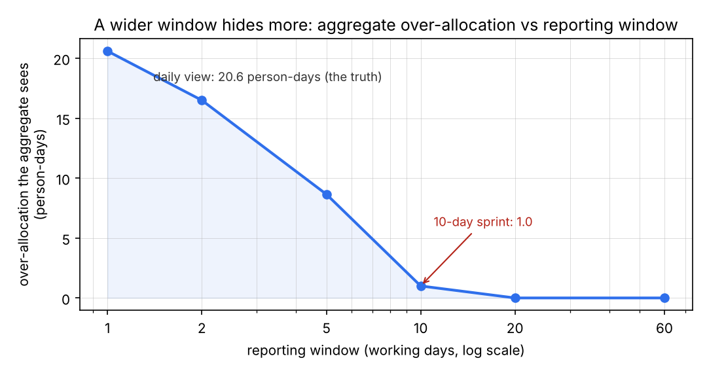
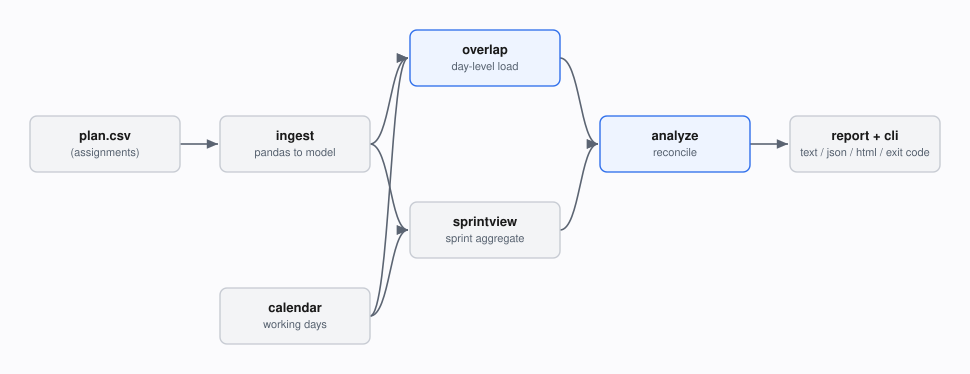
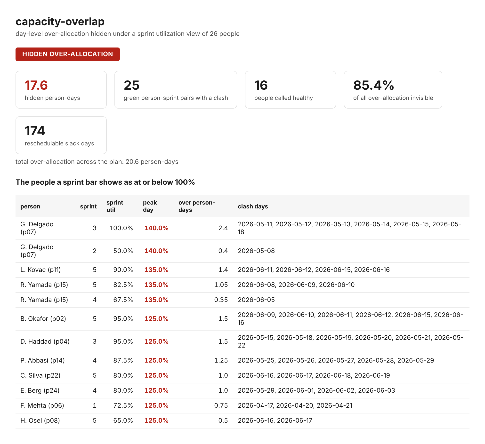

# capacity-overlap

**Finds the person-days of over-allocation that a sprint utilization view hides, by rebuilding each person's load one working day at a time instead of averaging it across the sprint.**

[](https://github.com/OWNER/capacity-overlap/actions/workflows/ci.yml)


A resource plan is normally read one number per person per sprint: planned effort over capacity, a tidy percentage. That number sums a person's work across the whole sprint and divides by its length, so it cannot see two tasks from different workstreams landing on the same calendar days. The clash exists only at the day level. A person can read 80% for the sprint and be double-booked on four of its days.

### Four questions this answers that a sprint utilization bar cannot

1. For the people the sprint view calls healthy, how much over-allocation is sitting underneath, in person-days?
2. How far is a person's worst day from the bar that represents their sprint?
3. Is the over-allocation real concurrency, or does it dissolve the moment you allow a little slack?
4. Which workstream pulls produce the clashes, so a plan can be fixed rather than just flagged?

## The uncomfortable numbers

On a seeded plan of 26 people across four workstreams over six sprints:

- **17.6 hidden person-days** of over-allocation, across **25 person-sprint pairs** that read at or below 100%, affecting **16 people the sprint view** calls healthy.
- That is **85.4% of it invisible** at the sprint level: of 20.6 person-days in total, only three are visible as a utilization above 100%.
- The worst case **reads 100.0% for the sprint** and **peaks at 140%** on a single day. Another sprint for the same person shows **a 90-point gap**: it sits at 50% across the sprint while that person hits 140% on one day.
- Where the tool is weakest, stated up front: most of that 17.6 is light double-booking. Allow a quarter-FTE of slack and only **1.85 hidden person-days remain** across three people. The signal is real, but its severity is a distribution, not a single alarming headline, and the result rests entirely on the plan's declared allocations being accurate (ADR-003).

Every figure in this document is re-measured from the code by CI: the analysis runs on a committed fixture, the test suite reports **124 tests** at **100% line coverage**, and a number checker fails the build if any figure here drifts from what the code produces.

## Quickstart

Prerequisites: Python 3.11 or newer. No network, no credentials.

```bash
pip install -e ".[dev]"

# the headline, straight from the committed plan
capacity-overlap analyze data/plan.csv

# re-measure every number in this README and fail on any drift, offline
make verify
```

`make verify` runs lint, the tests, the coverage floor, the experiments, and the number checker, and must pass from a fresh clone with no network.

## What the sprint view hides

The aggregate and the day-level view are computed by separate modules so they can be set against each other. The aggregate (`sprintview`) reproduces the averaging faithfully, including the flaw; the day-level view (`overlap`) materialises each assignment onto its working days and sums the concurrent load; `analyze` calls a person-sprint **hidden** when the aggregate reads at or below 100% and yet a day inside it is over capacity.

| view | what it reports | over-allocation it sees |
| --- | --- | --- |
| a daily view | load per person per working day | 20.6 person-days (the truth) |
| the 10-day sprint | planned effort over capacity | the sprint reports 1.0 |

The second row is the whole problem: averaging over the ten-day window dilutes a concentrated peak until the aggregate reports almost none of the real over-allocation. See `experiments/exp_aggregation_window.py`.



## It is concurrency, not rounding

If the finding were noise, a small tolerance would erase it. It does not: even allowing 125% days (a tolerance of a quarter FTE), **1.85 hidden person-days remain** across three people.

| tolerance | hidden person-days | people |
| --- | --- | --- |
| 0.00 | 17.6 | 16 |
| 0.10 | 10.0 | 14 |
| 0.25 | 1.85 | 3 |
| 0.50 | 0 | 0 |

## Where the hidden work comes from

The sprint view cannot say where a clash originates; the day-level view attributes each over day to the workstreams the person is active in that day. The largest source is people pulled between cloud-migration and data-migration: **6.5 person-days, the largest** single combination. Every hidden person-day comes from a day spanning two or more workstreams, which is the signature of cross-workstream pulls rather than overloading inside one team. See `experiments/exp_workstream_attribution.py`.

## The cost against the buy

| this costs | this buys |
| --- | --- |
| a day-indexed load per person (memory proportional to people times horizon) | the exact clash days, not just a flag, so a plan can be rescheduled |
| declared allocations treated as truth (ADR-003) | a fully offline, reproducible result with no timesheet feed |
| a strict gate that many teams will tune (ADR-005) | a default that reports the plan's own arithmetic, not a house tolerance |

## The bugs the measurement found

**A metric that read exactly zero.** The first cut reported "masked idle days": fully idle days sitting inside a conflicted sprint. It read zero on the seeded plan, every time. The cause was structural, not a staffing fact: the generator gives everyone a baseline task spanning the whole horizon, so no working day is ever fully idle, and the metric could never be anything but zero. The fix was to measure the quantity that actually supports the action, reschedulable slack: working days below capacity, where the clashing work could move. That number is 174 on the same plan, and it turns the finding from an accusation into a plan. Written up in `docs/war-story.md`.

## Architecture



```text
plan.csv -> ingest (pandas -> model) -> overlap (day-level load) -+
                     |                                            +-> analyze (reconcile) -> report + CLI
                 calendar ------------> sprintview (aggregate) ---+
```

## Evidence



The screenshot is generated by `tools/capture_screenshots.py` from the report the tool itself produces, and the tool reads back the verdict badge's colour and fails if it renders illegibly. The demo below is a replay of captured stdout paced by each command's measured wall time, not a screen recording; every line is real output. The manifest at `docs/video/manifest.json` lists each command with its exit code.


## The fixture

`data/plan.csv` is a committed, seeded plan of 26 people across 4 workstreams over 6 sprints (60 working days). It is generated with a fixed seed and regenerated by `make generate`, so every number above is reproducible from a fixed artefact. It plants three kinds of person on purpose, because the argument needs the contrast:

- clean people, whose concurrent load never crosses capacity;
- hidden people, whose sprint reads at or below 100% while specific days clash (the case under study);
- visibly overloaded people, whose sprint total itself clears capacity, so their over-allocation is already visible and the hidden share is a fraction of a real total rather than the whole of a cherry-picked one.

## What this cannot measure

- **Declared, not observed, effort.** Allocations are what the plan committed, not what was worked. This tool measures the plan's internal contradiction, not reality; a 50% allocation worked at 90% is invisible to it. ADR-003.
- **Uniform load within a task.** A task's allocation is spread evenly across its working days; a real ramp-up is not modelled. ADR-003.
- **No holiday calendar.** Working days are Monday to Friday everywhere; a public holiday is counted as capacity. ADR-002 states the boundary and why it is safe for the comparison.
- **Capacity is one FTE unless told otherwise.** A part-time person must be supplied as a fraction; the tool does not infer it.

None of these change the headline, because the comparison is between two readings of the *same* declared plan. The only input a reviewer must trust is the plan itself, and that is committed.

## Layout, exit codes, reproduction

```text
src/capacity_overlap/  calendar, model, ingest, overlap, sprintview, analyze, report, cli, generate
experiments/           four experiments, each writing JSON to docs/experiments/
tools/                 collect_metrics, check_numbers, check_coverage, render_diagrams, screenshots, demo
data/plan.csv          the committed seeded fixture
docs/                  metrics.json, experiments/, adr/, defense-guide.md, architecture.svg, img/, video/
```

`capacity-overlap analyze` exits with a code a CI gate can branch on, separating a finding from a failure:

| code | meaning |
| --- | --- |
| 0 | analysed, and no hidden over-allocation |
| 2 | analysed, and hidden over-allocation was found (the gate fails) |
| 3 | could not analyse: bad arguments or an unreadable plan |

Make targets: `make test`, `make coverage`, `make experiments`, `make receipts`, and `make verify`. The number checker matches anchor phrases rather than bare digits, so "17.6" is only accepted where the surrounding words say "hidden person-days", which is what stops a figure going stale while the sentence around it changes.

## Tech stack

| technology | role here | why this one |
| --- | --- | --- |
| Python 3.11+ | the whole tool | the algorithm is small and clear in plain Python; no heavier runtime earns its place |
| pandas | reading the plan CSV at the edge | a resource plan is a spreadsheet in every shop this targets; the core never touches pandas |
| stdlib datetime | the working-day calendar | the one correctness-critical primitive; a dependency here would hide the logic |
| pytest + coverage | 124 tests, coverage floor | property-named tests and an enforced floor, both read from machine-readable reports |
| matplotlib | the aggregation-window chart (evidence) | the sensitivity curve is clearer as a plot than a table |
| Playwright + Chromium | screenshot, diagram, demo | render the real HTML report and read back the badge's pixels |
| ruff | lint and format | one fast tool for both, pinned line length |

Five decisions are recorded as ADRs:

- [ADR-001: a day-level sweep, not a sprint-level aggregate](docs/adr/ADR-001-day-level-sweep-over-sprint-aggregate.md)
- [ADR-002: working-day calendar, no holidays](docs/adr/ADR-002-working-day-calendar.md)
- [ADR-003: declared allocations, observed effort out of scope](docs/adr/ADR-003-declared-allocations.md)
- [ADR-004: a committed fixture plus a seeded generator](docs/adr/ADR-004-committed-fixture.md)
- [ADR-005: exit-code semantics and an opt-in strict gate](docs/adr/ADR-005-exit-codes-and-gate.md)

## The Pivot and future work

Out of scope on purpose: **a rescheduler** that moves clashing work into the slack days it already reports. The trigger to build it is a second input the tool does not have today, a per-task constraint set (earliest start, latest finish, who can do it), without which a suggested move is just a guess. Until then the tool names the clash and the slack; it does not resolve them.

A v2 would need:

- Part-time and leave calendars per person, so capacity is a daily series rather than a constant. First metric to watch: how many current "hidden" days are explained purely by someone being part-time.
- A holiday calendar per region (ADR-002's boundary). First metric: the change in horizon working days once holidays are removed.
- An ingest adapter for a real tool's export (Jira, MS Project) behind the same model, so the fixture is one source among several. First metric: the share of real assignments that fail validation on first import.
